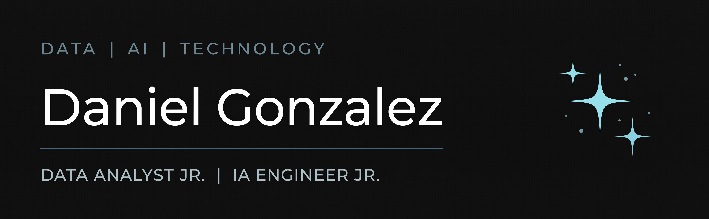

<!-- ═══════════════ HERO ═══════════════ -->

  

<h1 align="center">Dani Gonzalez</h1>

  <b>Data Analyst</b> &nbsp;·&nbsp; <b>Junior AI Engineer</b> &nbsp;·&nbsp; <b>ICT Engineer</b>

  <i>Turning data into insights and ideas into intelligent solutions.</i>

  
  
  
  

  <a href="#about">About</a> &nbsp;·&nbsp;
  <a href="#focus">Focus</a> &nbsp;·&nbsp;
  <a href="#projects">Projects</a> &nbsp;·&nbsp;
  <a href="#stack">Stack</a> &nbsp;·&nbsp;
  <a href="#background">Background</a> &nbsp;·&nbsp;
  <a href="#certifications">Certifications</a> &nbsp;·&nbsp;
  <a href="#contact">Contact</a>

 

<!-- ═══════════════ ABOUT ═══════════════ -->

## About

<h3 align="center">I turn scattered data into systems people can actually use.</h3>

  ICT Engineer from Puebla, Mexico 🇲🇽 — working where <b>data</b>, <b>security</b> and <b>AI</b> meet. 
  I don't just analyze information: I structure it, automate it and make it easy to act on.

<table>
  <tr>
    <td align="center" width="33%">
      <h4>🔎 Analyze</h4>
      Enterprise security datasets, events and alerts, investigated with SQL, Python and Google SecOps.
    </td>
    <td align="center" width="33%">
      <h4>🧱 Structure</h4>
      Messy spreadsheets turned into clean, searchable knowledge bases and BI-ready models.
    </td>
    <td align="center" width="33%">
      <h4>⚡ Automate</h4>
      Repetitive work replaced by workflows and AI-assisted development, so teams focus on decisions.
    </td>
  </tr>
</table>

  
  
  
  

 

<!-- ═══════════════ FOCUS ═══════════════ -->

## Focus

> **Where I'm putting my energy right now.**

<table>
  <tr>
    <td width="33%" valign="top">
      <h4>🚀 Shipping</h4>
      What I do day to day at <b>T-Systems</b>
        
      <b>Security data</b> investigation &amp; analysis 
      <b>SharePoint</b> knowledge repositories 
      <b>Power Automate</b> workflows 
      <b>Claude Code</b> to customize enterprise solutions
    </td>
    <td width="33%" valign="top">
      <h4>🧠 Leveling up</h4>
      Skills I'm building in public
        
      <b>GenAI</b> &amp; AI Agents 
      <b>Prompt Engineering</b> 
      <b>Python</b> for data &amp; automation 
      <b>Data Engineering</b> &amp; ETL
    </td>
    <td width="33%" valign="top">
      <h4>🤝 Let's build</h4>
      Projects I'd love to join
        
      <b>BI</b> &amp; analytics dashboards 
      <b>GenAI</b> applications 
      <b>ETL</b> &amp; data integration 
      <b>Automation</b> that saves real hours
    </td>
  </tr>
</table>

 

<!-- ═══════════════ PROJECTS ═══════════════ -->

## Projects

> **Problem → Solution → Outcome.** Every project starts with a real business pain. Click a title to open its repository.

 

### [01 &nbsp;Business Intelligence & Analytics](https://github.com/Danivinho1/Business_Intelligence_Analytics)
<code>MySQL</code> · <code>ETL</code> · <code>OLAP</code> · <code>Power BI</code> · <code>DAX</code> · <code>Excel</code>

<table>
  <tr>
    <td width="33%" valign="top"><b>🎯 Problem</b> Data lived in multiple sources, with no single view to support decisions.</td>
    <td width="33%" valign="top"><b>🛠️ What I built</b> Relational DB in MySQL, full ETL pipeline, an OLAP cube and interactive Power BI dashboards with DAX KPIs.</td>
    <td width="33%" valign="top"><b>✅ Outcome</b> One reliable, documented data model and visual reports ready for data-driven decisions.</td>
  </tr>
</table>

  

 

### [02 &nbsp;AI-Assisted Knowledge Management](https://github.com/Danivinho1/ai-assisted-knowledge-management)
<code>Claude Code</code> · <code>Prompt Engineering</code> · <code>JSON</code> · <code>SharePoint</code>

<table>
  <tr>
    <td width="33%" valign="top"><b>🎯 Problem</b> Critical security information was hard to browse in default enterprise interfaces.</td>
    <td width="33%" valign="top"><b>🛠️ What I built</b> Custom Gallery views and visual cards on SharePoint Lists, with JSON generated and refined through iterative prompting with Claude Code.</td>
    <td width="33%" valign="top"><b>✅ Outcome</b> A cleaner, faster way to find and understand information, built with AI instead of weeks of manual coding.</td>
  </tr>
</table>

  

 

### [03 &nbsp;Security Knowledge Base](https://github.com/Danivinho1/security-knowledge-base)
<code>SharePoint</code> · <code>Microsoft Lists</code> · <code>Power Automate</code> · <code>Excel</code>

<table>
  <tr>
    <td width="33%" valign="top"><b>🎯 Problem</b> IOCs and past investigations were buried in Excel files, hard to search and easy to lose.</td>
    <td width="33%" valign="top"><b>🛠️ What I built</b> Cleaned, standardized and classified the data, then migrated it into structured Lists with custom Gallery views.</td>
    <td width="33%" valign="top"><b>✅ Outcome</b> Instant retrieval of known IOCs and alerts, plus an automated weekly update workflow <i>(in progress)</i>.</td>
  </tr>
</table>

  

 

<!-- ═══════════════ STACK ═══════════════ -->

## Stack

**Languages**&nbsp;

**Data**&nbsp;

**AI**&nbsp;

**Cloud & Enterprise**&nbsp;

**Security**&nbsp;
`Google SecOps` &nbsp; `YARA-L 2.0` &nbsp; `UDM Search`

 

<!-- ═══════════════ BACKGROUND ═══════════════ -->

## Background

<table>
  <tr>
    <td width="50%" valign="top">
      <h4>🎓 Education</h4>
      <b>Information &amp; Communications Technology Engineering</b> 
      Instituto Tecnológico de Puebla · Puebla, Mexico
        
      Foundation in software, databases, networks and data-driven systems.
    </td>
    <td width="50%" valign="top">
      <h4>🌎 Languages</h4>
      🇲🇽 <b>Spanish</b> — Native 
      🇺🇸 <b>English</b> — B2 · Upper-intermediate 
      🇩🇪 <b>German</b> — Basic
    </td>
  </tr>
</table>

 

<!-- ═══════════════ CERTIFICATIONS ═══════════════ -->

## Certifications

<table>
  <tr>
    <td width="33%" valign="top">
      <h4>🤖 AI &amp; GenAI</h4>
      <b>Claude Code in Action</b> Anthropic  
      <b>Generative AI Fundamentals</b> Databricks  
      <b>AI Agent Fundamentals</b> Databricks  
      <b>AI Fundamentals</b> DataCamp
    </td>
    <td width="33%" valign="top">
      <h4>📊 Data &amp; Code</h4>
      <b>Databricks Fundamentals</b> Databricks  
      <b>Intermediate Python</b> DataCamp  
      <b>Intermediate SQL</b> DataCamp
    </td>
    <td width="33%" valign="top">
      <h4>☁️ Cloud</h4>
      <b>Microsoft Azure AI Essentials</b> Microsoft  
      <b>Google Cloud Computing Foundations</b> Google
    </td>
  </tr>
</table>

 

<!-- ═══════════════ CONTACT ═══════════════ -->

## Contact

  Open to learning, sharing ideas and collaborating. 
  The best way to reach me is LinkedIn.

  

  <i>Always learning · always building · always improving</i>

